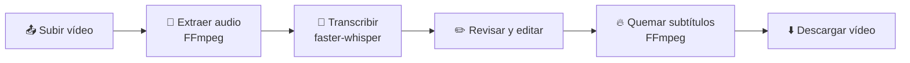

<div align="center">

# 🎬 Subtitulator

### Subtítulos automáticos para tus vídeos — transcribe, revisa y quema.

Sube un vídeo sin subtítulos, deja que la IA transcriba el audio en local,
revísalo a tu gusto y descárgalo con los subtítulos quemados en la imagen.

[](https://github.com/l-i408/subtitulator/actions/workflows/ci.yml)
[](LICENSE)
[](https://www.python.org/)
[](https://react.dev/)
[](https://www.docker.com/)
[](https://github.com/SYSTRAN/faster-whisper)

</div>

> [!NOTE]
> **100 % local y privado.** La transcripción usa `faster-whisper` en tu propia máquina:
> tus vídeos nunca salen de ahí y no necesitas ninguna API de pago.

<p align="center">
  
</p>

<p align="center">
  <a href="docs/assets/demo.mp4"><b>▶ Ver la demo completa (57 s)</b></a>
</p>

---

## ✨ Características

- 🎙️ **Transcripción local** del audio con `faster-whisper` (sin coste, sin enviar datos).
- 🌍 **Multi-idioma** — selecciona el idioma del audio o deja la detección automática.
- ✏️ **Editor de revisión** — corrige el texto y ajusta los tiempos antes de renderizar.
- 🎨 **Estilo personalizable** — fuente, tamaño, color, color de borde y posición.
- 🔥 **Subtítulos quemados** en el vídeo (formato ASS bajo el capó, siempre visibles).
- 🗂️ **Historial** de trabajos persistido en SQLite.
- ⚙️ **Procesamiento en segundo plano** con seguimiento de progreso en vivo.

---

## 🔄 Cómo funciona



Es una **automatización determinista** (Whisper + FFmpeg), no un agente: rápida,
predecible y reproducible.

---

## 🧱 Stack

| Capa | Tecnología |
|------|-----------|
| Backend | Python 3.11 · **FastAPI** (tareas en segundo plano) |
| Transcripción | **faster-whisper** (local, modelo `small` por defecto, CPU `int8`) |
| Audio / vídeo | **FFmpeg** (extracción de audio y quemado de subtítulos) |
| Subtítulos | Formato **ASS** |
| Base de datos | **SQLite** |
| Frontend | **React 18** · Vite · TypeScript · Tailwind CSS · Framer Motion |
| Despliegue | **Docker** · Docker Compose |

---

## 🚀 Instalación

### Opción A — Docker (recomendada)

```bash
git clone https://github.com/l-i408/subtitulator.git
cd subtitulator
docker compose up --build
```

- Frontend: **http://localhost:5173**
- Backend (API + Swagger): **http://localhost:8000/docs**

> El modelo Whisper `small` (~466 MB) se descarga automáticamente en el **primer**
> trabajo y queda cacheado en un volumen; las siguientes transcripciones van directas.

### Opción B — Local (desarrollo)

**Backend** (requiere [FFmpeg](https://ffmpeg.org/) instalado en el sistema):

```bash
cd backend
python -m venv .venv && source .venv/bin/activate   # Windows: .venv\Scripts\activate
pip install -r requirements.txt
cp .env.example .env
uvicorn app.main:app --reload
```

**Frontend:**

```bash
cd frontend
npm install
cp .env.example .env
npm run dev
```

---

## 🖥️ Uso

1. **Sube** un vídeo (`mp4`, `mov`, `mkv`, `avi`, `webm`) y elige idioma y modelo.
2. Espera a la **transcripción** (barra de progreso en vivo).
3. **Revisa y edita** el texto y los tiempos en el editor.
4. Ajusta el **estilo** de los subtítulos con vista previa.
5. **Quema** los subtítulos y **descarga** el vídeo final. Si quieres usar la transcripción editada en otro reproductor, elige **Subtítulos SRT** o **Subtítulos VTT** en esa misma pantalla.

---

## 📁 Estructura del proyecto

```
subtitulator/
├── backend/                 # API FastAPI + pipeline de transcripción/render
│   ├── app/
│   │   ├── main.py          # Endpoints
│   │   ├── services/        # audio · transcription · subtitle · render · job
│   │   ├── repositories.py  # Persistencia SQLite
│   │   └── ...
│   └── tests/               # pytest (fases 1–7)
├── frontend/                # React + Vite + TS + Tailwind
│   └── src/
│       ├── components/      # Upload · Progress · Editor · Style · Download · History
│       ├── api/             # Cliente HTTP tipado
│       └── hooks/           # useJobPolling
├── docs/                    # plan.md · tests.md · github.md · AGENTS/CLAUDE
└── docker-compose.yml
```

---

## 🧪 Tests

```bash
# Backend
cd backend && pytest

# Frontend
cd frontend && npm test
```

Cobertura actual: **57 tests backend** + **12 tests frontend** (ver [`docs/tests.md`](docs/tests.md)).

---

## 🗺️ Roadmap

- [ ] Personalización avanzada de subtítulos (sombra, fondo, karaoke por palabra).
- [ ] Aceleración por **GPU/CUDA** para modelos grandes.
- [ ] Traducción opcional (subtítulos en idioma distinto al audio).
- [x] Exportar también `.srt` / `.vtt` aparte del vídeo quemado.

---

## 🤝 Contribuir

¡Las contribuciones son bienvenidas! Lee [`CONTRIBUTING.md`](CONTRIBUTING.md) y el
[código de conducta](CODE_OF_CONDUCT.md) antes de abrir un PR.

## 📄 Licencia

Distribuido bajo licencia **MIT**. Ver [`LICENSE`](LICENSE).

<div align="center">
<sub>Hecho con 🎬 y FFmpeg.</sub>
</div>
